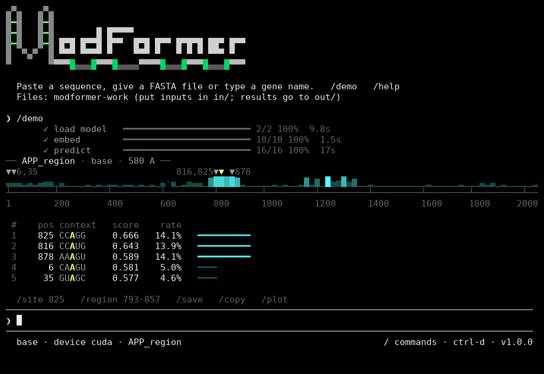

# Command line

[← README](README.md)



## Commands

```bash
modformer                                      # interactive session
modformer GGGAUCC...                           # RNA or DNA, 64 nt or longer
modformer transcripts.fa -o sites.tsv          # every record in a FASTA file
modformer APP --region 67248-69295             # gene name: pick an isoform, score positions 67248 to 69295 of its pre-mRNA
modformer APP --site 67993                     # the anchor containing position 67993
modformer App --species mouse --site 1494      # the same gene in mouse (default human)
modformer APP --site 67993 --model ft --context hek293ft   # fine-tuned model
modformer APP --region 67248-69295 --plot app.png   # also save the rate track
modformer fetch                                # download weights ahead of time
```

## Options

| Option | |
|---|---|
| `--site N` | only the 64-nt anchor containing position N (1-based) |
| `--region A-B` | only positions A to B (1-based, inclusive) |
| `-o FILE` | write the table (TSV); `-` for standard output |
| `--top K` | sites to list (default 5) |
| `--plot FILE` | save the rate track (.png, .pdf, .svg) |
| `--model base\|ft` | base (default) or fine-tuned; `ft` needs `--context` |
| `--context NAME` | `observed`, `hek293ft`, `neuro2a` or `mouse-brain` |
| `--species NAME` | genome to look a gene name up in: `mouse`, `rat`, `zebrafish`, `fly`, `worm`, or any Ensembl species (default human; an Ensembl id carries its own) |
| `--isoform ID` | row number, transcript id or name, `canonical`, `mane` or `longest` |
| `--spliced` | score the spliced transcript, not the pre-mRNA |
| `--device DEVICE` | `cpu` or `cuda` (default cuda if available) |
| `--plain` | no color, no animation |
| `-y` | no prompts: download as needed, default isoform |

## Session

`modformer` with no input. Paste a sequence, a FASTA path or a gene name.
Options follow the input: `App --species mouse`, `APP --isoform mane`.

| Command | |
|---|---|
| `/site N` | the anchor containing position N, with its predicted fold |
| `/region A-B` | positions A to B |
| `/all` | the whole transcript |
| `/model [base \| ft CONTEXT]` | switch model; no argument lists them |
| `/top K` | sites to list |
| `/save [FILE]` · `/plot [PNG]` · `/copy [table]` | save the table, save the rate track, copy |
| `/demo` | score the bundled APP region |
| `/help` · `/clear` · `/quit` | help, clear, quit (or Ctrl-D) |

`score`: resemblance to observed editing sites, 0 to 1. `rate`: predicted edited fraction.
