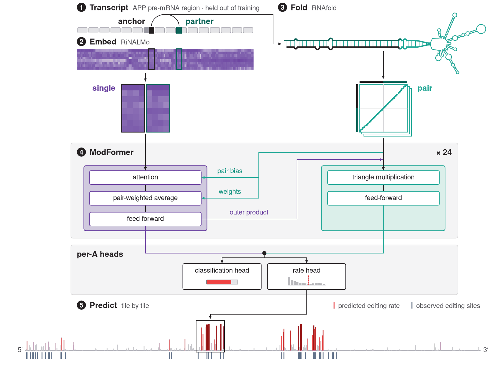
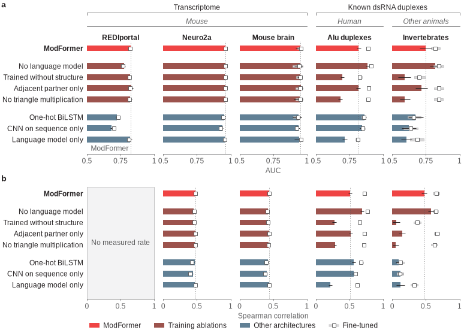
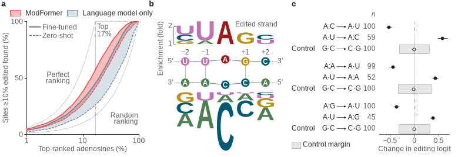
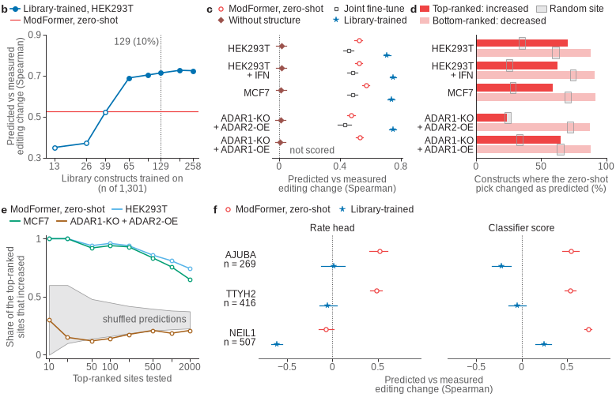

<p align="center">

</p>

<p align="center">A unified structure-aware model of transcriptome-wide A-to-I RNA editing</p>

<p align="center">
<a href="#install">Install</a> · <a href="#use">Use</a> · <a href="CLI.md">Command line</a> · <a href="#figures">Figures</a> · <a href="#cite">Cite</a>
</p>

<p align="center">

</p>

Sequence from [RiNALMo](https://github.com/lbcb-sci/RiNALMo), pairing from [ViennaRNA](https://www.tbi.univie.ac.at/RNA/),
24 [Pairformer](https://doi.org/10.1038/s41586-024-07487-w) blocks.

## Install

```bash
curl -LsSf https://raw.githubusercontent.com/nygctech/ModFormer/main/install.sh | sh
```

Linux or Apple-silicon Mac, Python 3.10 to 3.14.
Existing environment: `pip install git+https://github.com/nygctech/ModFormer`

On a shared machine whose jobs run on a GPU, install the GPU build:

```bash
curl -LsSf https://raw.githubusercontent.com/nygctech/ModFormer/main/install.sh | MODFORMER_TORCH=gpu sh
```

## Use

```bash
modformer APP --region 67248-69295             # gene name, sequence or FASTA file
modformer                                      # interactive session
```

```python
import modformer
table = modformer.predict(sequence)            # one row per adenosine
```

- `edit_score`: resemblance to observed editing sites, 0 to 1
- `predicted_rate`: predicted edited fraction, 0 to 1
- `position`, `context` and the partner window paired with each anchor

**[Command line →](CLI.md)**

## Figures

| | Notebook |
|---|---|
|  | [Figure 2](notebooks/fig2_transfer.ipynb) |
|  | [Figure 3](notebooks/fig3_substrate_selection.ipynb) |
|  | [Figure 4](notebooks/fig4_variant_effects.ipynb) |

Extended Data: [1](notebooks/ed1_benchmarks.ipynb), [2](notebooks/ed2_training_data.ipynb),
[3](notebooks/ed3_library_screen.ipynb).

Run them:

```bash
git clone https://github.com/nygctech/ModFormer && cd ModFormer
python3 -m venv .venv && . .venv/bin/activate
pip install ".[notebooks]"
jupyter lab notebooks/
```

## Weights, data, licenses

- Weights: [doi:10.5281/zenodo.24300574](https://doi.org/10.5281/zenodo.24300574), base and fine-tuned, seed 1313
- Data: [doi:10.5281/zenodo.24300820](https://doi.org/10.5281/zenodo.24300820), training labels, splits, figure source tables
- Code: MIT. Weights and data: CC BY-NC 4.0.
- RiNALMo-giga (`multimolecule/rinalmo-giga`, via `multimolecule` 0.2.0): AGPL-3.0, downloaded separately, not redistributed.
- ViennaRNA 2.7.2: its own license (free for research and commercial use, no redistribution for a fee), installed separately, not redistributed.

## Cite

> Slater C, Nassar E, Dreesen Bonet N, Yuan B, Lee JH, Domović D, Espinosa L, Garbulowski M,
> Daly A, Vicković S. ModFormer: A unified structure-aware model of transcriptome-wide
> A-to-I RNA editing. bioRxiv (2026).

Also cite the work ModFormer builds on:

- RiNALMo: Penić RJ, Vlašić T, Huber RG, Wan Y, Šikić M. Nat Commun 16, 5671 (2025).
  [doi:10.1038/s41467-025-60026-5](https://doi.org/10.1038/s41467-025-60026-5)
- ViennaRNA: Lorenz R, Bernhart SH, Höner zu Siederdissen C, et al. Algorithms Mol Biol 6, 26 (2011).
  [doi:10.1186/1748-7188-6-26](https://doi.org/10.1186/1748-7188-6-26)
- Pairformer (AlphaFold 3): Abramson J, Adler J, Dunger J, et al. Nature 630, 493-500 (2024).
  [doi:10.1038/s41586-024-07487-w](https://doi.org/10.1038/s41586-024-07487-w)
